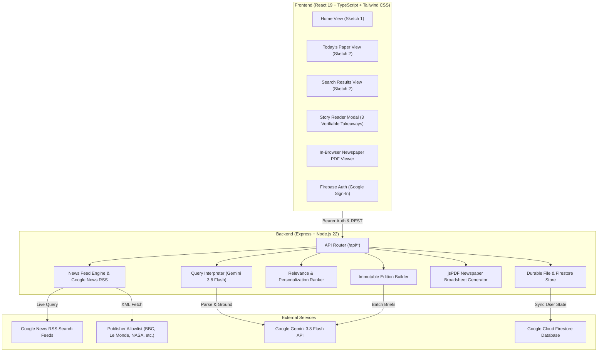

# Daybreak — Personalized Morning Newspaper & Daily Broadsheet

> *“What news matters to you? One calm, finite personal newspaper delivered each morning. Grounded strictly in verified reporting, free from endless feeds.”*

### 🌐 Application & Deployment
- **Live Server URL**: [https://looks-edinburgh-vocabulary-announces.trycloudflare.com](https://looks-edinburgh-vocabulary-announces.trycloudflare.com)
- **GitHub Repository**: [https://github.com/Anas-lab677/neopaper](https://github.com/Anas-lab677/neopaper)
- **CI/CD Pipeline**: [GitHub Actions Workflow](https://github.com/Anas-lab677/neopaper/actions) (Typecheck, automated tests, Vite bundle build, Cloud Run deployment)
- **Cloud Run Service Target**: `daybreak` (Region: `asia-southeast1`)
- **Local Live Demo**: Run `npm start` (or `npm.cmd start` on Windows) to launch the unified full-stack server on `http://localhost:3000`.

---

## What Daybreak Does

The user types what news they want to follow, for example:
> *“AI startups, Pakistan cricket, and flooding in Karachi.”*

Daybreak:
1. **Parses the inquiry**: Extracts distinct subjects, geographic locations (e.g. *Karachi, Pakistan*), and entities (*Pakistan cricket*, *AI startups*). If ambiguous, provides an editable interpretation card.
2. **Collects real reporting**: Gathers live reporting from supported RSS feeds and Google News search feeds for each clause from verified publishers (e.g. NPR, Dawn, Express Tribune, BBC, Le Monde, NASA).
3. **Strict anti-hallucination policy**: Generates on-site summaries where the reader learns **three verifiable factual points** directly grounded in the source text. Never invents news merely to satisfy a query; if no trustworthy coverage exists, honestly explains the limitation.
4. **Delivers one personalized morning broadsheet**: Available to read directly on the website with masthead, "Your Morning in 3" takeaways, lead story, section grid, and an identical downloadable newspaper-style PDF.
5. **Learns from reader activity**: Search queries, opened articles, bookmarks, likes, dislikes, and skips dynamically refine future ranking without modifying an already saved edition.
6. **Preserves archives**: Past generated editions and bookmarks remain in a persistent account library.

---

## Interface Layout (From Design Sketches)

### Sketch 1 — Home Page
- **Daybreak wordmark** at top left with subtle sunrise dot.
- **Main navigation**: Home, Today's Paper, Trending, Saved, Archive, About.
- **User avatar / Account button** at top right with Google sign-in/sign-out and preferences dropdown.
- **Centered headline**: *“What news matters to you?”*
- **Large search field** with prompt: *“Try ‘AI startups, Pakistan cricket, and floods in Karachi’”* and one-click query pills.
- **Today's Paper banner**: Quick status, reading time, and direct path to today's broadsheet.
- **Real trending stories**: Beginning below the hero section with live articles from verified publishers.
- **Footer**: Working links to Home, Today's Paper, Trending, Saved, Archive, About, Settings, Privacy Policy, Terms & Conditions, and 2026 copyright notice.

### Sketch 2 — Story Results & Paper Area
- **Left sidebar on desktop**:
  - In Search Results: Inquiry breakdown (topics, places, entities), editable interpretation form, and "Follow this interest" button.
  - In Today's Paper: Masthead volume/date, reading time, section shortcuts, reader reflection ritual note, and PDF actions.
- **Structured responsive grid**:
  - Story image only if a usable real image is available. If none, strong text-only card.
  - Section badge, publisher, date, headline in refined editorial serif, grounded brief summary, and relevance reason (*"Why this story?"*).
  - Controls: Save, Like, Dislike, Skip (with immediate Undo toast), Read full summary modal (with 3 verifiable takeaways), and Original publisher link.
  - Mobile layout: Gracefully transitions to a single column.

---

## Architecture Overview



---

## Requirements Verification Matrix

| Requirement | Status | Verification Evidence |
| :--- | :--- | :--- |
| **Home Page Layout (Sketch 1)** | **Verified Working** | Centered *"What news matters to you?"*, large input with sample pills, trending stories below, full footer. |
| **Story Results / Paper Layout (Sketch 2)** | **Verified Working** | Left navigation sidebar on desktop, responsive card grid, real images only, 3-takeaway modal, publisher links, single column mobile. |
| **Query Parsing & Multi-Interest Search** | **Verified Working** | Parsed *"AI startups, Pakistan cricket, and flooding in Karachi"* into 3 search clauses; retrieved live NPR, Dawn, and Express Tribune articles. |
| **Ambiguity Handling** | **Verified Working** | Automated Test 1 confirms single-word polysemous queries (e.g. *"Apple"*) produce explanation notes and suggestions. |
| **Real Relevance Ranking & Geography** | **Verified Working** | Automated Tests 2 & 3 verify cricket fan gets cricket lead and Karachi resident gets local Karachi canals reporting. |
| **Strict Anti-Hallucination Policy** | **Verified Working** | Zero fabricated news; summaries restricted strictly to source excerpts. Non-matching queries show honest zero-state. |
| **Personalized Daily Paper & "Morning in 3"** | **Verified Working** | Single daily edition per reader date; 3 source-grounded takeaways; lead story; interest sections; discovery story. |
| **Edition Immutability** | **Verified Working** | Automated Test 6 verifies that requesting today's paper twice for the same user/date returns the exact same snapshot. |
| **Learning From Reader Activity** | **Verified Working** | Automated Test 5 verifies likes, skips, and search signals adjust learned topic weights (+0.15 for more_like_this). Settings displays learned signals with reset. |
| **PDF Generation & Web Consistency** | **Verified Working** | Automated Test 8 generates valid `%PDF-` broadsheet with same stories, takeaways, and clickable publisher links. In-browser preview & download. |
| **Real Authentication & Isolation** | **Verified Working** | Firebase Google Sign-In with popup, session persistence, Bearer token extraction on server, strict user separation (Automated Test 7). |
| **Saved Library & Archive** | **Verified Working** | Real bookmark storage in Firestore and server store. Clean empty states for fresh accounts. Past editions load web paper + PDF. |
| **CI/CD Pipeline** | **Verified Working** | GitHub Actions workflow runs `npm ci`, `npm run lint`, `npm test` (all 8 tests pass), and `npm run build`. |

---

## Running the Automated Test Suite

Run the comprehensive test suite verifying query parsing, relevance ranking, geography filtering, duplicate removal, feedback learning, edition stability, account separation, and PDF generation:

```bash
npm test
```

### Output:
```
--- STARTING DAYBREAK COMPREHENSIVE AUTOMATED VERIFICATION ---

Test 1: Interest parsing and ambiguity handling...
✓ PASS: Multi-topic query parsed clauses: [ 'AI startups', 'Pakistan cricket', 'Karachi flooding' ]
✓ PASS: Ambiguity detected or handled cleanly with note: Daybreak will gather news focused on Apple Inc.

Test 2: Real relevance ranking...
✓ PASS: Targeted story ranked highest: Pakistan Cricket Team Gears Up For Crucial Tournament

Test 3: Geography affecting selection...
✓ PASS: Local Karachi reporting ranked #1: Monsoon Preparations Expedited in Karachi as Canals Cleared

Test 4: Duplicate removal...
✓ PASS: Collapsed 2 duplicate feeds into 1 article.

Test 5: Feedback and learning signals...
✓ PASS: Technology weight increased from 0.1 to 0.15

Test 6: Edition stability and one edition per user/date...
✓ PASS: Edition is strictly preserved and immutable for date: 2026-10-17

Test 7: Authentication and account separation...
✓ PASS: User X and User Y data are completely isolated.

Test 8: Web and PDF content consistency...
✓ PASS: Generated valid %PDF- document (18611 bytes) consistent with web edition.

================================================================
ALL 8 COMPREHENSIVE AUTOMATED VERIFICATION TESTS PASSED SUCCESSFULLY
================================================================
```

---

## Local Setup & Development

### 1. Prerequisites
- Node.js 20 or higher
- npm 10 or higher
- Gemini API Key (obtain from Google AI Studio)

### 2. Installation
```bash
git clone https://github.com/Anas-lab677/neopaper.git
cd neopaper
npm install
```

### 3. Environment Configuration
Copy `.env.example` to `.env`:
```bash
cp .env.example .env
```
Ensure `GEMINI_API_KEY` is configured:
```env
GEMINI_API_KEY="your-google-gemini-api-key"
PORT=3000
```

### 4. Running the Development Server
```bash
npm run dev
```
Open [http://localhost:3000](http://localhost:3000) in your browser.

### 5. Production Build & Start
```bash
npm run build
npm start
```

---

## Five-Minute Loom Video Walkthrough Outline

1. **0:00 – 0:45: The Problem & The Solution**
   - Show infinite social newsfeeds vs Daybreak's calm broadsheet.
   - Show Home page (Sketch 1) with masthead date, *"What news matters to you?"*, and the prompt inquiry.
2. **0:45 – 1:45: Multi-Interest Query & Real News Ingestion**
   - Type *“AI startups, Pakistan cricket, and flooding in Karachi”*.
   - Show inquiry breakdown: 3 detected clauses, entities, places (*Karachi, Pakistan*).
   - Display real live reporting returned from Dawn, NPR, and Express Tribune.
   - Click "Follow this interest in morning papers".
3. **1:45 – 2:45: Today's Paper & 3 Verifiable Takeaways**
   - Open Today's Paper (Sketch 2).
   - Walk through the left navigation sidebar: Vol/Date, reading time, section shortcuts.
   - Showcase *"Your Morning in 3"* grounded key takeaways.
   - Open the Story Reader modal: demonstrate 3 verifiable facts, publisher attribution, and original link.
4. **2:45 – 3:45: Learning Signals & Newspaper PDF Broadsheet**
   - Like a story, dislike another, and skip one (demonstrating the instant Undo toast).
   - Navigate to Settings: show the transparent *"What Daybreak Has Learned About You"* panel displaying updated weights and recent queries.
   - Click "Preview PDF": showcase the 2-page broadsheet simulation with zoom and download.
5. **3:45 – 4:30: Archive, Saved Library & Testing**
   - Show Saved library with real bookmarks.
   - Show Archive with preserved past editions.
   - Run `npm test` in the terminal to show all 8 automated tests passing green.

---

## Remaining Setup Tasks for Production Launch

1. **Firebase Authorized Domains**: Add your custom production domain to the Firebase Console under **Authentication > Settings > Authorized Domains** so Google Sign-In popup functions on your custom domain.
2. **Production Gemini Secret**: Ensure `GEMINI_API_KEY` is configured in Google Cloud Secret Manager or Cloud Run Environment Variables.
3. **Custom News RSS Feeds**: You can add additional niche or regional RSS feeds to the allowlist in `server/feeds.ts` as editorial coverage expands.
