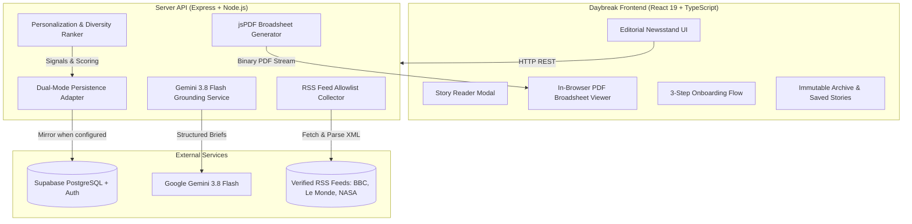

# Daybreak — Your Personal Morning Paper

> *“A little perspective. A world of possibility. Your morning, made personal.”*

### 🌐 Live Application
- **Live Preview URL**: [https://ais-pre-l227tx3zr5jrrty2sber6q-964792235520.asia-southeast1.run.app](https://ais-pre-l227tx3zr5jrrty2sber6q-964792235520.asia-southeast1.run.app)
- **Dev URL**: [https://ais-dev-l227tx3zr5jrrty2sber6q-964792235520.asia-southeast1.run.app](https://ais-dev-l227tx3zr5jrrty2sber6q-964792235520.asia-southeast1.run.app)

Daybreak is a finite, personalized daily morning newspaper web application built for mindful news consumption. Instead of endless social scrolling and algorithmic engagement traps, Daybreak delivers **one dated, bite-sized edition each morning** tailored to your interests and reading budget (5, 10, or 20 minutes), with source-grounded briefs from verified publisher feeds, reflection prompts, and an identical downloadable newspaper-style broadsheet PDF.

---

## Architecture Overview



---

## Verified RSS Feeds Allowlist

Daybreak collects news exclusively from an editable, server-side allowlist of verified publisher RSS and Atom feeds:

1. **World**: BBC News (`https://feeds.bbci.co.uk/news/world/rss.xml`)
2. **World**: Le Monde in English (`https://www.lemonde.fr/en/international/rss_full.xml`)
3. **Business**: BBC Business (`https://feeds.bbci.co.uk/news/business/rss.xml`)
4. **Technology**: BBC Technology (`https://feeds.bbci.co.uk/news/technology/rss.xml`)
5. **Science**: BBC Science & Environment (`https://feeds.bbci.co.uk/news/science_and_environment/rss.xml`)
6. **Science & Space**: NASA Breaking News (`https://www.nasa.gov/feed/`)
7. **Climate & Environment**: Le Monde Environment (`https://www.lemonde.fr/en/environment/rss_full.xml`)
8. **Culture**: Le Monde Culture (`https://www.lemonde.fr/en/culture/rss_full.xml`)
9. **Sports**: Le Monde Sports (`https://www.lemonde.fr/en/sports/rss_full.xml`)

Each feed is fetched with bounded 4-second timeouts, XML parsing, HTML entity sanitization, URL deduplication, and error boundaries. If any single publisher feed fails or is blocked, the edition compiles seamlessly from the remaining available feeds.

---

## How to Add or Disable a Feed

You can manage feeds dynamically in two ways:

### 1. In the Web UI
Click the **Feeds & Sources** button in the top navigation bar to open the **Verified Publisher Allowlist** modal:
- **Disable/Enable**: Click the **Disable / Enable** button on any feed to test error handling or adjust publisher coverage.
- **Add a Feed**: Enter the publisher name, valid RSS/Atom URL, and category, then click the `+` button.

### 2. Via Server API
- **List feeds**: `GET /api/feeds`
- **Toggle feed status**:
  ```bash
  curl -X POST http://localhost:3000/api/feeds/toggle \
    -H "Content-Type: application/json" \
    -d '{"id": "bbc-tech", "active": false}'
  ```
- **Add custom feed**:
  ```bash
  curl -X POST http://localhost:3000/api/feeds/add \
    -H "Content-Type: application/json" \
    -d '{"name": "Wired News", "url": "https://www.wired.com/feed/rss", "category": "Technology"}'
  ```

---

## Real Data vs. Demo Data

| Component | Status | Data Origin |
| :--- | :--- | :--- |
| **Today's Paper** | **REAL DATA** | Live-fetched and parsed from active RSS feeds (NASA, BBC, Le Monde). |
| **Grounded Briefs** | **REAL DATA** | Grounded summaries and takeaways generated strictly from source text via **Gemini 3.8 Flash**, with graceful fallback to publisher excerpts if offline or rate-limited. |
| **Demo Readers** | **DETERMINISTIC FIXTURES** | Two labeled sample reader profiles: **Sara** (Tech/Science/Climate) and **David** (Business/Sports/World) allow immediate comparison. |
| **Archive** | **HYBRID** | Displays real frozen snapshots generated during reader sessions, seeded with 2 labeled historical editions for immediate inspection. |
| **PDF Broadsheet** | **REAL DATA** | Vector PDF built dynamically from the exact same frozen `edition_items` snapshot. |

---

## Personalization & Learning Model

Daybreak uses a transparent, explainable scoring formula:

$$\text{Score} = w_{\text{topic}} \cdot \text{TopicMatch} + w_{\text{kw}} \cdot \text{KeywordMatch} + w_{\text{fresh}} \cdot \text{Recency} + w_{\text{learned}} \cdot \text{FeedbackDelta} - \text{Penalty}_{\text{repeat}}$$

- **Topic Match (+35 pts)**: Reader explicitly subscribes to the category.
- **Keyword Match (+25 pts)**: Story headline or description contains the reader's specific interest phrases (e.g. *"AI tools"*, *"Space exploration"*).
- **Recency (+20 pts max)**: Linear decay over 48 hours to prefer breaking developments.
- **Feedback Learning (+0.3 / -0.3)**:
  - *"More like this"*: +0.3 delta to category weight.
  - *"Less like this"*: -0.3 delta to category weight.
  - *"Save story"*: +0.15 delta to category weight.
  - *"Skip"*: Hides story immediately with an Undo toast without permanently penalizing the category.
- **Publisher Diversity Cap**: Restricts any single publisher to $\le 35\%$ of an edition.
- **Discovery Mode**: If enabled, reserves 1 slot for an engaging story from outside the reader's typical topics.

---

## Inngest Scheduled Daily Delivery Setup

To run automated daily edition generation in the background at each reader's preferred morning time (e.g. 7:00 AM in their timezone):

1. **Install Inngest**:
   ```bash
   npm install inngest
   ```
2. **Define Inngest Function**:
   ```ts
   import { Inngest } from 'inngest';
   import { buildDailyEdition } from './server/editionBuilder.ts';
   import { dbStore } from './server/store.ts';

   export const inngest = new Inngest({ id: 'daybreak' });

   export const dailyPaperCron = inngest.createFunction(
     { id: 'generate-daily-editions' },
     { cron: '0 * * * *' }, // Runs hourly to check due timezones
     async ({ step }) => {
       const readers = [dbStore.getProfile('reader-a'), dbStore.getProfile('reader-b')];
       for (const reader of readers) {
         await step.run(`build-edition-${reader.id}`, async () => {
           await buildDailyEdition(reader);
         });
       }
     }
   );
   ```
3. Set `INNGEST_SIGNING_KEY` and `INNGEST_EVENT_KEY` in `.env`.
*(Note: Manual refresh and creation in the UI works out-of-the-box without requiring Inngest).*

---

## Local Development & Setup

### Prerequisites
- Node.js 20+
- npm or bun

### 1. Clone & Install
```bash
git clone <repo-url>
cd daybreak
npm install
```

### 2. Environment Configuration
Copy `.env.example` to `.env`:
```bash
cp .env.example .env
```
Add your optional keys:
```env
GEMINI_API_KEY="your-gemini-api-key"
# Optional Supabase integration:
SUPABASE_URL="https://your-project.supabase.co"
SUPABASE_SERVICE_ROLE_KEY="your-supabase-key"
```

### 3. Start Full-Stack Dev Server
```bash
npm run dev
```
Visit `http://localhost:3000` to read today's edition.

### 4. Run Automated Verification Tests
```bash
npx tsx server/tests.ts
```

---

## 5-Minute Demo Script (For Judges)

1. **Minute 1: The Concept & Problem**
   - Introduce Daybreak: A calming, finite personal newspaper with a clear beginning and end.
   - Show the newspaper masthead, issue date, volume, and reading time estimate.
2. **Minute 2: Personalization Comparison (Sara vs. David)**
   - Click **Sara** in the top bar: Observe lead story on NASA Space exploration and Climate urban cooling.
   - Click **David** in the top bar: Observe lead story immediately changes to Global Sports and Business markets.
3. **Minute 3: Grounded Briefs & Reader Actions**
   - Click **Read brief →** on any card: Note the concise, factual takeaways and prominent **"Read original article at [Publisher] ↗"** link.
   - Tap **Save**: Note it appears in the **Saved** tab with instant undo.
   - Tap **More like this**: View how it updates the **"What your reading is teaching us"** table in **Your interests**.
4. **Minute 4: The Physical Broadsheet PDF**
   - Click **Preview newspaper**: Explore the interactive in-browser broadsheet viewer with zoom and page turns.
   - Click **Download PDF**: Open the downloaded vector PDF; verify stories, ordering, and takeaways match the web edition 1:1.
5. **Minute 5: Feed Resilience & Reflection**
   - Scroll to the bottom of Today's paper to see **"Three things to take into today"** and type a private reflection note.
   - Open **Feeds & Sources**: Disable a feed to prove that the edition still compiles with zero crashes from remaining feeds.

---

## Cost & Usage Model

Assuming 1,000 active daily readers:
- **RSS Collection**: Server fetches 9 feeds once every 30 minutes = ~432 HTTP requests/day (negligible bandwidth).
- **Gemini Processing**: ~30 unique new articles per day processed via `gemini-3.8-flash`:
  - 30 articles × 1,000 input tokens = 30k tokens/day.
  - At standard Gemini 3.8 Flash rates, daily AI cost is under **$0.02 / day**.
  - Article briefs are cached at the article level and shared across all readers, preventing redundant LLM calls.
- **Database Storage**: ~1 MB per day for snapshots, easily fitting within Supabase's free tier.

---

## 🚀 GitHub Repository & CI/CD Pipeline

### 1. Connecting to Your Public GitHub Repository
To link this project to your public GitHub repo:
```bash
# 1. Create a public repository on GitHub (e.g. "daybreak")
# 2. Add the remote and push the verified source code:
git remote add origin https://github.com/<your-username>/<repo-name>.git
git branch -M main
git push -u origin main
```

### 2. GitHub Actions CI/CD (`.github/workflows/ci.yml`)
The repository includes a comprehensive GitHub Actions workflow that automatically runs on every push and pull request to `main`:

1. **Continuous Integration (`test-and-build`)**:
   - Checks syntax and types (`npm run lint`).
   - Runs automated verification tests (`npm test`) covering feed parsing, news deduplication, and edition snapshot consistency.
   - Compiles production distribution bundle (`npm run build`).
2. **Continuous Deployment (`deploy-cloud-run`)**:
   - Deploys source to Google Cloud Run in `asia-southeast1`.
   - Injects `GEMINI_API_KEY` from Google Secret Manager / repository secrets.

#### Steps to Activate Automated Cloud Run CD:
1. In Google Cloud Console, create a Service Account with:
   - `roles/run.admin`
   - `roles/iam.serviceAccountUser`
   - `roles/storage.admin` (for Cloud Build container artifacts)
2. Generate a Service Account JSON Key.
3. In your GitHub repository, navigate to **Settings > Secrets and variables > Actions**.
4. Add a repository secret named **`GCP_SA_KEY`** with the JSON key contents.
5. Once added, every merged change to `main` automatically runs tests and deploys directly to Cloud Run!
*(Until `GCP_SA_KEY` is added, the deployment step skips gracefully while the test and build CI runs).*
